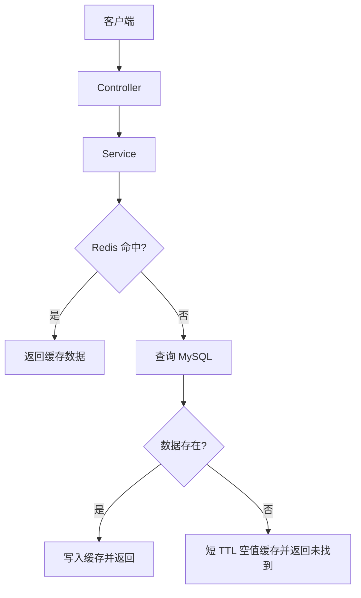

# PLpay Pull Request（PR）提交守则

## 1. PR 提交规范

### 1.1 新增功能

- 在 PR 的 Description（描述）中说明添加了什么功能、为什么需要添加，以及涉及哪些模块。
- 如果新增功能涉及多个模块、复杂调用链或架构变化，需要插入 Mermaid 架构图，展示新功能与现有项目之间的关系。
- 如果只是新增简单接口或局部功能，能够通过文字清楚说明，则不强制绘制架构图。

### 1.2 修改功能

- 在 PR 的 Description 中说明修改了什么、为什么修改，以及解决了什么问题。
- 如果修改涉及业务流程、模块关系或架构调整，需要使用 Mermaid 展示修改前（Before）与修改后（After）的流程或架构，并解释调整原因。
- 如果只是修改空值判断、异常处理或修复简单 Bug，则不需要绘制架构图，以问题描述、修改说明和测试结果为主。

### 1.3 同时新增与修改功能

- 如果新增与修改属于同一个需求或共同解决同一个问题，可以放在同一个 PR 中。
- 在 Description 中明确区分新增内容和修改内容，分别说明。
- 如果新增功能和修改内容没有直接关系，应拆分为不同的 PR，避免一个 PR 承担多个无关任务。

### 1.4 代码重构

- 如果代码存在高耦合、低内聚、重复逻辑或职责混乱等问题，需要在 Description 中说明：
    1. 原有代码存在什么问题。
    2. 为什么需要重构。
    3. 采用了什么重构方案。
    4. 重构后的代码结构发生了什么变化。
    5. 原有功能是否保持完整，如何验证。
- 如果重构涉及模块关系或调用链调整，应提供 Before / After 架构图。
- 如果只是局部方法提取、变量重命名等简单重构，则不强制绘图。
- 重构原则上不改变对外行为。如果改变了业务行为，需要在 PR 中明确说明，不应将功能变更隐藏在重构之中。

**统一原则：是否绘制 Mermaid，不取决于 PR 属于新增、修改还是重构，而取决于修改的复杂程度及架构图能否帮助评审理解。具体标准参考第 7 章。**

## 2. 分支命名规则

### 2.1 命名格式

建议统一使用：

`<type>/<short-description>`

例如：

- `feat/order-timeout-cancellation`
- `fix/cache-penetration`
- `refactor/user-service`
- `docs/pr-guidelines`

命名说明：

- `type`：表示本次分支的主要修改类型。
- `/`：用于分隔修改类型和修改内容。
- `short-description`：使用简短英文描述本次修改的具体内容。
- 多个英文单词使用 `-` 连接。
- 建议统一使用小写字母。
- 分支名称应表达修改目的，而不是使用 `update`、`new-branch` 等模糊名称。

### 2.2 Type 类型说明

| Type | 使用场景 | 示例 |
|---|---|---|
| `feat` | 新增原本不存在的功能或能力 | `feat/user-registration` |
| `fix` | 修复已有功能中的错误，使其恢复预期行为 | `fix/login-token-expiration` |
| `refactor` | 调整代码结构，但不改变外部行为 | `refactor/order-service` |
| `test` | 新增或修改测试代码 | `test/payment-callback` |
| `docs` | 修改 README、API 文档或其他文档 | `docs/api-documentation` |
| `perf` | 优化程序性能 | `perf/redis-cache-query` |
| `build` | 修改构建系统、依赖或打包配置 | `build/maven-dependencies` |
| `ci` | 修改持续集成配置或自动化流程 | `ci/github-actions` |
| `style` | 调整代码格式，不改变程序行为 | `style/code-formatting` |
| `chore` | 其他维护性调整 | `chore/project-cleanup` |

### 2.3 类型选择原则

- 原本没有这个功能，现在新增了这个功能：使用 `feat`。
- 原本有这个功能，但是运行结果不符合预期，现在修复：使用 `fix`。
- 原本功能正常，只是代码结构不好，需要整理：使用 `refactor`。
- 原本功能正常，但是执行效率较低，现在进行性能优化：使用 `perf`。
- 修改涉及多种类型时，以 PR 的主要目的决定分支类型。

例如：

- 修复缓存击穿问题，即使需要新增互斥锁等代码，主要目的仍然是修复缺陷，可以使用 `fix`。
- 新增商品排行榜功能，即使同时修改现有 Service，主要目的仍然是新增功能，可以使用 `feat`。

### 2.4 分支命名补充规则

如果需要关联 Issue，可以采用：

`<type>/<issue-number>-<short-description>`

例如：

- `fix/123-cache-penetration`
- `feat/456-order-timeout`

以上属于 PLpay 建议规范，并非 GitHub 强制要求。参与其他开源项目时，应优先遵循目标仓库的分支命名要求。

## 3. Commit 原则

- 标题表达做了什么，不要只写 `update`、`fix bug`、`修改代码`。
- Commit 尽量保持逻辑单一：一组相关的修改可组成一个 Commit；无关修改不要捆绑。
- 检查是否意外提交密钥、令牌、账号、数据库密码、个人信息、IDE 缓存、日志或构建产物。
- 不为了制造贡献数量而故意拆分无意义 Commit。
- 若项目要求 Signed-off-by（DCO）、签名提交、CLA 或其他流程，按仓库要求办理，不要默认所有项目都要求。
- PR 创建后谨慎变更已有公开提交历史；`rebase` / `--force-with-lease` 可能影响评审，应遵守仓库协作约定。

## 4. 代码修改守则

### 4.1 修改范围

- 优先最小有效变更；不要顺便改不相关的文件。
- 不在修复 Bug 时顺手重构整个模块，除非两者不可分割且已解释原因。
- 尽量遵循现有模块边界、命名习惯、日志风格、异常处理与配置机制。
- 需要新增依赖、配置项、数据库字段或迁移脚本时，说明引入原因及兼容风险。
- 公开 API、数据结构、数据库 Schema 或缓存 Key 语义变化，应说明对已有调用方的影响。
- 同一 PR 可以包含同一需求下的新增、修改和重构，但不应包含无关任务。

### 4.2 Java / Spring Boot 常见检查项

- 业务正确性：成功路径、失败路径、边界值、空值与重复请求。
- 异常与日志：异常类型恰当；日志不泄露敏感数据；不要无意义吞异常。
- 事务一致性：事务范围合理；数据库与外部系统调用的失败场景有明确处理方案。
- 并发与幂等：并发写入、重试、回调重复、锁失效等场景可解释且被测试。
- Redis / 缓存：Key 命名、TTL、缓存失效、空值缓存、更新一致性及故障降级。
- 数据库：SQL 参数化；索引与查询计划合理；迁移脚本考虑历史数据和回滚。
- 安全：鉴权、输入校验、权限边界、依赖漏洞和配置泄露。
- 可维护性：避免重复逻辑、过度抽象、不必要的新工具类与过度设计。

以上是按修改内容选择的检查维度，不是每个 PR 都必须新增这些机制。

## 5. 测试与验证守则

### 5.1 测试写什么

| 修改类型 | 推荐验证 |
|---|---|
| Bug 修复 | 修复前可复现，修复后通过的回归测试 |
| 新增接口 | 正常、非法输入、未授权、边界及失败情况 |
| Redis 改动 | 命中、未命中、过期、并发、Redis 异常或降级（按适用范围） |
| 支付 / 回调 | 重复回调、乱序、超时、重试、幂等 |
| 重构 | 原有用例通过、外部行为保持一致 |
| 性能优化 | 可复现的前后对比，记录环境与数据规模 |
| 文档改动 | 命令、链接、示例及渲染正确 |

### 5.2 Java 项目命令示例

```bash
# 仅为 Maven 项目举例；最终以项目构建规范和模块配置为准
./mvnw test

# 若项目没有 Maven Wrapper，可使用已安装的 Maven
mvn test
```

- 大型多模块项目不一定适合每次全量运行，优先执行与修改范围相关的模块测试，同时关注仓库 CI。
- 记录执行命令、测试环境、结果；若测试未运行，必须写明原因。
- “本地通过”不等于“CI 一定通过”，更不等于所有平台和部署场景都通过。

## 6. PR 标题与描述

### 6.1 标题

通用建议格式（非 GitHub 强制）：

```text
fix(cache): prevent cache penetration for missing shop IDs
feat(order): support timeout cancellation
```

标题应当简洁、具体、与实际修改一致；不要把多个无关变化堆在同一标题中。若目标仓库规定了标题格式，必须优先遵循。

### 6.2 描述至少回答五个问题

1. **Why**：为什么修改？对应什么问题或需求？
2. **What**：改动了什么？涉及哪些模块？
3. **How**：核心实现思路是什么？为什么这样设计？
4. **Test**：如何验证？哪些测试已运行，结果是什么？
5. **Risk**：是否有兼容性、性能、部署或回滚风险？

小型 PR 可以简化描述，复杂 PR 应补充关键调用链、前后对比、截图或架构图。

是否附带架构图，以第 7 章的规则为准。

### 6.3 Issue 关联语法

```text
Closes #123
Fixes #123
Resolves #123
```

- 上述关键词可用于在符合 GitHub 条件时关联并自动关闭 Issue；PR 目标为仓库默认分支是自动关闭关键词生效的前提之一。
- 只想引用、暂时不应自动关闭的 Issue，可以写 `Related to #123`，不要误用 Closes。
- 如目标 Issue 在其他仓库，可写 `Fixes OWNER/REPO#123`。

## 7. Mermaid 架构图 / 流程图守则

GitHub 支持在 PR 描述、评论及 Markdown 文件中直接渲染使用 `mermaid` 语言标识的代码块。

**Mermaid 的使用以修改复杂程度为依据，而不是以 PR 类型为依据。**

### 7.1 需要附图的情况

- 新增功能涉及多个模块之间的调用关系。
- 新增复杂业务流程，如支付回调、消息投递、分布式锁与故障恢复。
- 修改已有请求处理流程、数据流、组件依赖或架构边界。
- 重构涉及多个模块之间的职责或调用关系调整。
- 单纯文字不容易说明修改前与修改后的差异。

不需要强制附图的情况：

- 单行空指针修复。
- 简单异常处理。
- 简单 Bug 修复。
- 简单文档更新。
- 局部变量重命名。
- 局部代码整理。
- 简单接口新增或修改。

### 7.2 绘图方式

按照修改类型决定绘图方式：

- **新增复杂功能**：绘制新增功能与现有系统之间的架构关系。
- **修改复杂功能**：绘制 Before / After，展示修改前后的差异。
- **复杂重构**：绘制重构前后的模块关系，解释职责如何变化。
- **简单修改**：不必绘图，使用文字说明和测试结果即可。

### 7.3 Mermaid 示例：缓存查询链路



### 7.4 绘图要求

- 与实际代码一致，不要把理想化设计当作已实现功能。
- 只画帮助评审理解修改的节点，避免大而全。
- 重点标注新增 / 调整的路径、失败分支和关键边界。
- 架构变化较大时，使用 Before / After 两张图。
- 提交前使用 GitHub 的 Preview 检查图是否正常渲染。
- 不要为了满足格式要求而绘制没有实际信息价值的架构图。

## 8. 可直接复制的通用 PR 描述模板

### 8.1 PR 基础模板

```markdown
## Summary

<!-- 用 1～3 句话说明这个 PR 解决什么问题。 -->

## Related Issue

- Closes #123

## Background

<!-- 问题背景、现状、复现条件和影响范围。 -->

## Changes

### Added
<!-- 新增内容，没有则删除 -->

### Modified
<!-- 修改内容，没有则删除 -->

### Refactored
<!-- 重构内容，没有则删除 -->

## Design / Implementation

<!-- 关键实现思路；小型修改可省略。 -->

## Testing

- [ ] 单元测试（命令、结果）：
- [ ] 集成测试（命令、结果）：
- [ ] 手动复现（步骤、结果）：
- [ ] 回归验证（覆盖范围、结果）：

未执行的测试及原因：

## Compatibility / Risks

- 兼容性影响：
- 可能风险：
- 配置或迁移要求：
- 回滚方式（适用时）：

## Checklist

- [ ] 阅读了项目贡献规范与 PR 模板
- [ ] 修改范围与问题一致，没有混入无关改动
- [ ] 检查过 diff，没有提交敏感信息
- [ ] 必要的测试已执行，结果如实记录
- [ ] 文档 / 配置 / 测试已按需同步更新
- [ ] PR 标题、Commit、Issue 关联符合项目规范
```

### 8.2 架构图的使用方式

当修改符合第 7 章规定的复杂场景时，在 PR 描述的 `Design / Implementation` 中插入 Mermaid。

新增功能时，展示新增功能与现有系统的关系。

修改或重构时，如果涉及原有架构变化，则展示：

- Before：修改前的架构或调用流程。
- After：修改后的架构或调用流程。
- Explanation：为什么调整，调整后解决了什么问题。

简单修改不需要保留 Mermaid 部分。

### 8.3 模板使用提醒

- `Closes #123` 是占位内容，没有对应 Issue 时删除或替换。
- 不存在的 Added、Modified、Refactored 部分可以删除。
- 未运行的测试应写成“未执行 / 原因”，不能暗示测试通过。
- 不强制填写与修改无关的内容。
- PR 描述应以帮助维护者理解修改为目的，而不是为了填写模板而填写。

## 9. 提交前最后检查（单页清单）

### 9.1 需求与范围

- [ ] 知道问题是什么、为什么要改、预期结果是什么。
- [ ] 已查看贡献指南、Issue、相关已合并 PR。
- [ ] 方案与维护者已有讨论不冲突。
- [ ] 本次 PR 不包含无关修改。

### 9.2 代码与安全

- [ ] 核对过 `git diff` / `git diff --cached`。
- [ ] 关键路径、异常、边界和兼容性已检查。
- [ ] 没有密钥、令牌、个人数据、无关构建文件。
- [ ] 新增依赖、配置、迁移和文档已按需说明。

### 9.3 测试与可评审性

- [ ] 修复类 PR 有明确复现与验证方法。
- [ ] 测试执行结果真实，未执行部分有说明。
- [ ] 复杂流程有必要的说明、示意图或对比数据。
- [ ] 已核对目标分支、提交记录与修改文件。

### 9.4 PR 元信息与协作

- [ ] PR 标题符合目标项目规范。
- [ ] Commit 格式符合目标项目规范。
- [ ] Issue 引用 / 关闭关键词使用正确。
- [ ] PR 描述回答 Why / What / How / Test / Risk。
- [ ] 分支命名符合第 2 章规范。
- [ ] Mermaid 架构图符合第 7 章规范（如适用）。