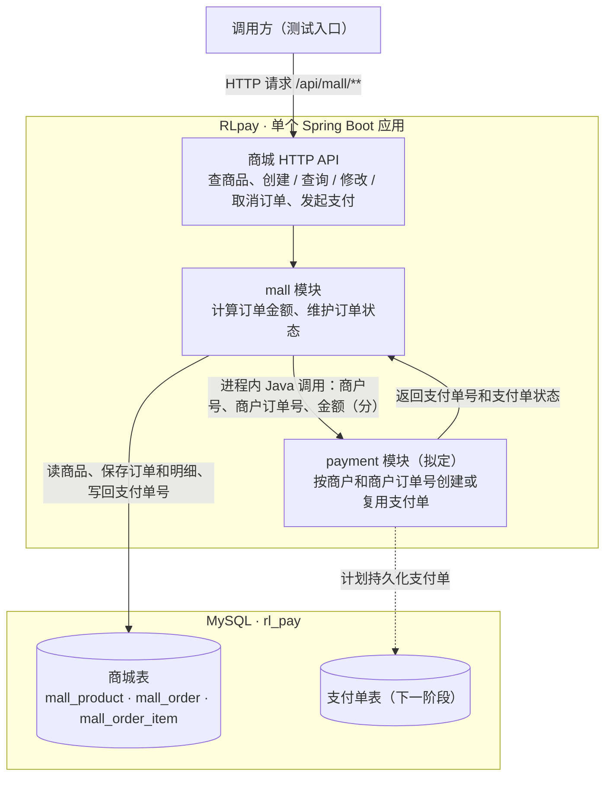

# 模拟商城接口与支付交接设计

本稿供确认。商城维护商品目录和业务订单。支付单由同一进程内的 `payment` 模块维护。固定模拟商户号为 `MALL_MOCK`，由商城服务端提供。

## 模块架构图



发起支付时，商城先保存 `PAYMENT_REQUESTED` 并提交事务，再调用支付模块。收到支付应答后，商城写回支付单号，并通过 HTTP 返回支付请求参数和应答。以 ¥17.90 为例，图中的金额字段传 `1790` 分。

## 本地运行与初始化

在 PowerShell 中激活 `test` profile，并为当前进程设置数据库凭据。该 profile 默认连接 `127.0.0.1:3306/rl_pay`，也可以用 `RLPAY_DB_URL` 覆盖地址。其他 profile 通过同一个环境变量指定完整 JDBC URL。

```powershell
$credential = Get-Credential -Message '输入本地 rl_pay 数据库的用户名和密码'
$env:SPRING_PROFILES_ACTIVE = 'test'
$env:RLPAY_DB_USERNAME = $credential.UserName
$env:RLPAY_DB_PASSWORD = $credential.GetNetworkCredential().Password
mvn spring-boot:run
```

需要初始化商城表时，在项目根目录执行以下命令，按提示输入数据库密码。脚本可以重复执行，已有商品数据会保留。

```powershell
mysql --host=127.0.0.1 --user=root --password --default-character-set=utf8mb4 --database=rl_pay -e "source db/mall-init.sql"
```

| 表 | 用途 |
| --- | --- |
| `mall_product` | 只读商品目录。脚本预置三款可下单商品 |
| `mall_order` | 商户订单号、状态、总金额、版本及已取得的支付单号 |
| `mall_order_item` | 商品、下单时的名称和单价快照、购买数量 |

金额统一使用整数分。创建和修改草稿时，服务端按当前商品价格重新计算总额。发起支付后，商城复用订单已保存的金额。

## HTTP 接口

| 方法与路径 | 输入 | 成功响应 |
| --- | --- | --- |
| `GET /api/mall/products` | 无 | `200`，可下单商品列表。每项包含 `productCode`、`name`、`priceCent` |
| `POST /api/mall/orders` | `items: [{productCode, quantity}]` | `201`，新建草稿，返回订单详情 |
| `GET /api/mall/orders/{merchantOrderNo}` | 路径中的商户订单号 | `200`，返回订单详情 |
| `PUT /api/mall/orders/{merchantOrderNo}` | 当前 `version` 和完整的 `items` | `200`，返回更新后的订单详情 |
| `DELETE /api/mall/orders/{merchantOrderNo}` | 路径中的商户订单号 | `204`，取消草稿。重复取消也返回 `204` |
| `POST /api/mall/orders/{merchantOrderNo}/payment` | 路径中的商户订单号 | `200`，返回商城实际交给支付模块的参数及支付模块的应答 |

订单详情包含 `merchantOrderNo`、`status`、`version`、`totalAmountCent`、可空的 `paymentOrderNo`，以及明细 `items`。明细包含 `productCode`、`productName`、`unitPriceCent`、`quantity`。商品编码作为稳定标识使用。

订单明细至少一行，最多 20 行。同一商品在一笔订单中只能出现一次，每行数量为 1–99。非法明细或金额溢出返回 `400`，商品或订单不存在返回 `404`，商品已停用、草稿版本过期或状态冲突返回 `409`。支付模块暂时不可用时返回 `503`，调用方可以对同一商户订单重试。

## 商城伪代码

```text
listProducts():
    返回 enabled = true 的商品，按 id 排序

buildOrderItems(inputItems):
    校验行数、商品编码唯一性、购买数量
    按商品编码批量加载商品，校验商品存在且可下单
    为每行保存 productId、商品名称快照、单价快照和数量
    对每行执行有溢出检查的单价乘数量，并执行有溢出检查的求和
    返回明细与总金额

createOrder(items):                         # 商城事务
    lines, total = buildOrderItems(items)
    merchantOrderNo = "MALL-" + UUID
    插入 DRAFT 订单和明细，version = 0
    返回订单详情

getOrder(merchantOrderNo):
    按商户订单号查询订单与明细
    返回订单详情，取消后仍可查询

updateOrder(merchantOrderNo, version, items):  # 商城事务
    按订单号锁定订单行（SELECT ... FOR UPDATE）
    要求订单为 DRAFT 且当前版本等于传入版本
    lines, total = buildOrderItems(items)
    替换整份订单明细，更新总金额并将 version 加 1
    返回订单详情

deleteOrder(merchantOrderNo):                # 商城事务
    按订单号锁定订单行
    若已为 CANCELLED，直接返回
    要求订单为 DRAFT
    将状态改为 CANCELLED，并将 version 加 1
```

## 发起支付与重试

`POST /api/mall/orders/{merchantOrderNo}/payment` 将草稿推进为 `PAYMENT_REQUESTED`。这个状态表示商城已经冻结支付金额，支付模块可能尚未收到请求。支付模块创建支付单后，商城保存其单号，后续由支付结果通知推进 `PAID`。

```text
requestPayment(merchantOrderNo):
    商城事务一:
        按订单号锁定订单行
        如果是 DRAFT，将状态改为 PAYMENT_REQUESTED，version 加 1
        否则要求状态为 PAYMENT_REQUESTED
        request = (MALL_MOCK, merchantOrderNo, order.totalAmountCent)
    提交事务一，释放商城订单行锁

    response = paymentOrderService.createOrGet(request)
    若调用暂时失败，返回 503，保留 PAYMENT_REQUESTED 供重试

    商城事务二:
        按订单号锁定订单行
        若尚未记录支付单号，保存 response.paymentOrderNo，version 加 1
        否则校验已记录的单号与 response.paymentOrderNo 相同
    返回 paymentRequest 和 paymentResponse
```

修改、取消和首次发起支付使用同一订单行锁。支付调用在商城事务外执行。假如支付单已经创建但商城写回失败，重试时仍会用相同的商户订单号和金额取得原支付单。

拟定的支付入口是进程内 Java 服务方法 `paymentOrderService.createOrGet(request)`。请求字段为 `merchantCode`、`merchantOrderNo`、`amountCent`。响应字段为 `paymentOrderNo`、`status`，此处以 `CREATED` 表示初始状态。支付模块按 `(merchantCode, merchantOrderNo)` 建唯一约束，重复请求金额一致时返回已有支付单，金额冲突时拒绝。支付单建表和持久化属于计划中的下一阶段。

## 验收示例

1. 查询商品目录，以 `{"items":[{"productCode":"MALL-NOTEBOOK","quantity":2}]}` 创建草稿。返回 `201`，总额为 2580 分。
2. 使用响应中的 `merchantOrderNo` 发起支付。示例响应同时展示商城请求和支付应答。

   ```json
   {
     "paymentRequest": {
       "merchantCode": "MALL_MOCK",
       "merchantOrderNo": "MALL-4acf4715-cd32-4360-8114-0aabf22d4517",
       "amountCent": 2580
     },
     "paymentResponse": {
       "paymentOrderNo": "PAY-000001",
       "status": "CREATED"
     }
   }
   ```

3. 对同一订单再次发起支付，预期拿到同一支付单号。此时修改或取消该订单应返回 `409`。
4. 另建一笔草稿，带当前版本修改数量并查回新金额。取消后查回 `CANCELLED`，再次取消仍应返回 `204`。
